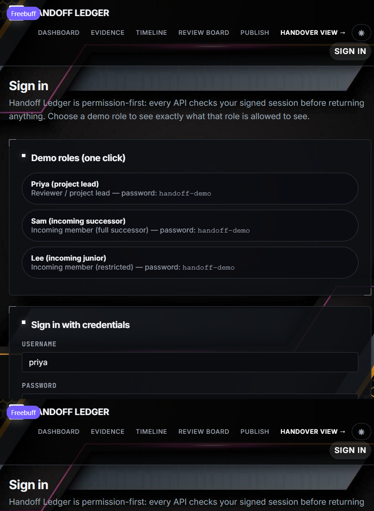
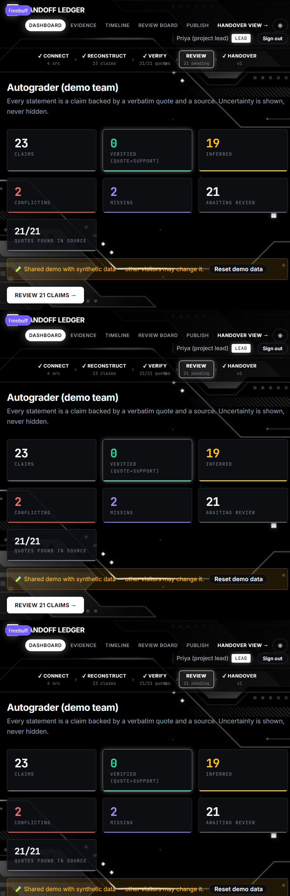

# Handoff Ledger

**Prevent critical knowledge from leaving with people.** A handover you can check — every claim carries its source, its status and its permission. Never a fluent guess.

Round 2 build of the competition plan. All demonstration data is synthetic and created during the build window.

Built with **Codebuff** 🤖 — the AI pair-programming agent — with human review
of every change; commit messages carry the same disclosure.

## What it does

1. **Connect** — import authorised sources (meeting notes, chat exports, task boards, docs); each source carries an access level (`public` / `internal` / `restricted`) and an explicit permission confirmation.
2. **Reconstruct** — the pipeline chunks each source and extracts structured claims (decision, owner, risk, dependency, open question, contact).
3. **Verify** — every claim must carry a verbatim quote; code checks the quote exact-matches its source (offsets recorded), and a batched support check asks whether the quote actually states the claim. Conflicting statements, stale items and missing rationale are detected and labelled honestly.
4. **Review** — a responsible person accepts, edits, rejects or marks each claim unknown. Every action is logged in an audit trail.
5. **Publish** — an immutable, versioned handover snapshot. Only reviewed claims (accepted / edited / unknown) and declared gaps are published; unreviewed claims are held back by the human review gate.
6. **Handover view** — the incoming person sees only what their role permits (`lead` / `successor` / `junior`), with an excluded-items indicator; restricted content is filtered **before** it ever reaches the view, and secrets are redacted as defense in depth.

Two more Round 2 views make every claim checkable:

- **Evidence inspector** (`/sources`) — the raw source with every cited quote highlighted, so any claim can be verified against its origin in one click.
- **Timeline** (`/timeline`) — key decisions, risks and unresolved discussions in order, with dates parsed verbatim from the sources (undated claims are honestly labelled, never guessed).

### The four honest statuses

| Status | Meaning |
|---|---|
| Verified | Directly supported by a verbatim quoted source passage |
| Inferred | Reasoned/extracted, labelled as such, needs reviewer confirmation |
| Conflicting | Sources disagree — both versions shown with their sources |
| Missing | Expected knowledge has no evidence — becomes a gap-interview question |

## Run it

```bash
npm install
npm run dev        # http://localhost:3000
npm run test       # 17 unit tests: redaction, quote matching, statuses, conflicts, permissions, timeline
npm run selftest   # in another terminal: 54-check planted-fact + permission-leak suite
```

Unit tests run in CI (GitHub Actions) on every push: typecheck + the suite above.

### Sign in

The login screen offers two paths — **one-click demo roles** (pick an account
and go straight in) or the **credentials form** (username + password
`handoff-demo`):

| Account | Role | Sees |
|---|---|---|
| **priya** | project lead | everything — all sources, extraction, review, publish |
| **sam** | incoming successor | public + internal sources; restricted excluded before the response is built |
| **lee** | incoming junior | public only; sees a count of excluded items, never their content |

The role comes from the signed session cookie (scrypt-hashed passwords,
HMAC-signed httpOnly cookie), never from the URL or request body; every API
endpoint returns 401 without a session. There is no self-registration — these
three seeded accounts are the demo's scope.

Seeded demo project ("Autograder") contains planted test facts:
two conflicting decisions (Postgres vs SQLite), one decision without rationale,
one stale task (auth refactor untouched 5 months), one confidential item (live
Stripe key in a restricted source), and one undocumented dependency (deploy SSH
password owned by the departing member).

### AI extraction (optional)

Set `GROQ_API_KEY` in the environment to extract claims with the Groq API
(`openai/gpt-oss-120b`, JSON-object output validated against the six allowed
claim types). Without a key the pipeline uses a deterministic heuristic
extractor — both paths feed the same verification gate: **a claim without an
exact-matching quote can never be Verified.** A second batched model call runs
the support check, so *Verified = quote found in the source AND the check says
the quote states the claim*; heuristic claims stay Inferred until a reviewer
confirms them.

**Data-handling policy:** `restricted` sources are processed entirely on this
server (heuristic extraction, no support check, local conflict verdicts) —
restricted content is never sent to the external model.

**Redaction notes:** credential-shaped strings, phone numbers and email
addresses are masked in every response for every role. The one documented
exception: `example.com` addresses are fake demo data and are kept as-is.

## Design

A dark **HUD theme** built on the [Adminator 4](https://github.com/puikinsh/Adminator-admin-dashboard)
token system (MIT), with a monochrome palette taken from the project's own
sci-fi wallpapers:




- **Wallpapers** in `public/` — `hud-frame.png` sits fixed behind every page,
  `login-frame.png` frames the sign-in screen; panels are translucent so the
  artwork reads through without hurting legibility.
- **White-glow accents** — active nav pills, capsule buttons, square markers,
  corner brackets and hatched dividers echo the wallpapers' highlights.
  Semantic status colors (verified / inferred / conflicting / missing) are
  kept because they carry meaning.
- **Light theme** — toggle in the header, persisted, with a pre-paint script
  so there is no flash of the wrong theme.
- **Fonts** — Inter + JetBrains Mono, loaded in `<head>` in parallel with the
  stylesheet (no render-blocking hop).

## Architecture

```
lib/session.ts    demo users, scrypt password hashes, signed httpOnly session cookie
lib/types.ts      data model: Source → Chunk → Claim → Evidence → ReviewAction → HandoverVersion
lib/extract.ts    chunking, claim extraction (Groq + heuristic), quote + support verification, conflict/staleness/gap detection
lib/permissions.ts role matrix, permission-first filtering, secret redaction
lib/seed.ts       synthetic demo project with planted facts
lib/store.ts      JSON-file store (swap target: SQLite/Postgres in Round 3)
components/       TopNav (active-route pills, theme toggle), UserBar
public/           HUD wallpapers
app/              Next.js App Router UI + API routes
```

## Self-test

`npm run selftest` walks the entire flow against a running server and asserts the plan's success criteria: all five planted facts found and correctly labelled (with the decoy pair NOT flagged as a conflict), no claim Verified without an exact-matching quote AND a passed support check, publish blocked with zero reviews, 401 without a session on every endpoint, zero permission leaks (restricted strings absent from every junior/successor response across every endpoint), the restricted-never-leaves-server policy, session-derived audit actors, immutable versioning (numbered snapshots each carrying a recomputable SHA-256 hash), conflict resolution (winner accepted, counterpart rejected), an explicit warning when a publish would confirm nothing (all-unknown handover), the prompt-injection line in the seed export producing **no** claim, and live timeline/evidence endpoints. Ground truth lives in `scripts/planted-facts.json`, shared with the Round 3 scorecard.

## Roadmap (per plan)

- **Round 3 commitments:** gap interview flow, permission-aware cited Q&A, version diff + acknowledgement tracking + evaluation scorecard.
- **Round 3 stretch:** knowledge-risk map, repository export import, Postgres+pgvector store.
